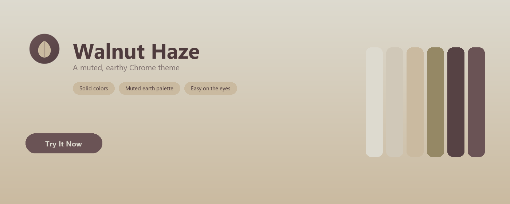
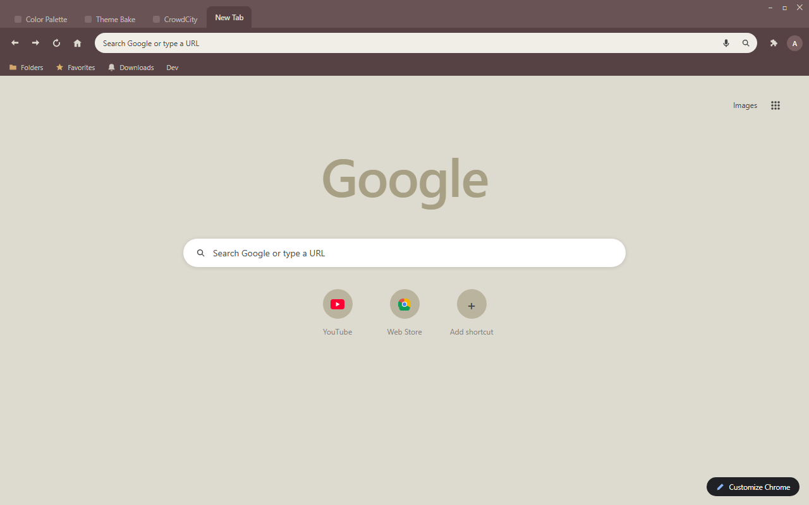
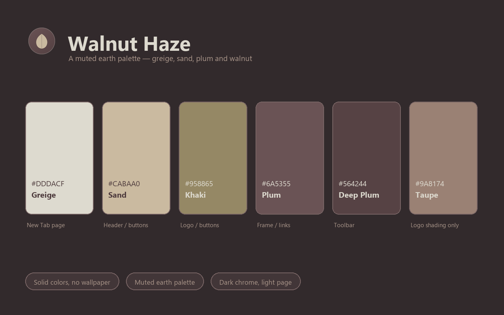

<p align="center">
  
</p>

<h1 align="center">Walnut Haze Theme</h1>

<p align="center">
  A muted, earthy Chrome theme in greige, sand, taupe and walnut tones — the quiet colours of driftwood and morning haze.
</p>

Walnut Haze pairs a walnut-plum frame with a deeper plum toolbar, then opens onto a soft greige New Tab Page warmed by sand and khaki accents. Cream ink keeps every tab, bookmark and toolbar icon crisp against the dark chrome, deep plum ink keeps the pale page readable, and a single-row shortcut layout with a color-matched Google logo keeps the New Tab Page clean.

<p align="center">
  
</p>

## Design Concept

Walnut Haze is built from a natural neutral palette: greige, sand, khaki, plum-brown and taupe. Every tone is heavily desaturated, so the theme reads as one quiet material rather than a set of colours — walnut wood and linen, with a little mist over it. Because the palette sits in a narrow mid band, contrast is carried by value: the darkest plum takes the browser chrome, the palest greige takes the page, and the mid-tone taupe is used for logo shading only, since it is too soft to carry text on either side.

| Color | Hex | RGB | Role |
|---|---|---|---|
| Greige | `#DDDACF` | 221, 218, 207 | New Tab background |
| Sand | `#CABAA0` | 202, 186, 160 | New Tab header / buttons |
| Khaki | `#958865` | 149, 136, 101 | New Tab buttons / logo accent |
| Plum | `#6A5355` | 106, 83, 85 | Frame / New Tab links |
| Deep Plum | `#564244` | 86, 66, 68 | Toolbar |
| Taupe | `#9A8174` | 154, 129, 116 | Logo shading only |
| Deep Plum Ink | `#4E3B3D` | 78, 59, 61 | New Tab text |
| Cream Ink | `#DDDACF` | 221, 218, 207 | Tab, bookmark and toolbar text |

## Features

- Pure color, no wallpaper — fast and distraction-free
- Muted earth palette: greige, sand, khaki and walnut plum in one quiet family
- Dark browser chrome over a pale page — strong contrast with a soft, natural feel
- Tab text, bookmark text and toolbar icons all share the same cream ink
- Single-row shortcut row and a color-matched Google logo for a clean New Tab Page
- No configuration needed — install and enjoy

## Preview

<p align="center">
  
</p>

<p align="center">
  
</p>

## Installation

### Load Unpacked (Development)

1. Download or clone this repository.
2. Open `chrome://extensions` in Chrome.
3. Enable "Developer mode" in the top right.
4. Click "Load unpacked" and select this folder (`walnut-haze-theme`).
5. The theme is now active.

### Web Store Packaging

```
chrome://extensions → Pack extension → select this folder → walnut-haze-theme.zip
```

Upload the resulting `.zip` to the Chrome Web Store developer dashboard.

## Files

| File | Purpose |
|---|---|
| `manifest.json` | Theme definition (single-file, inlined `theme` field) |
| `logo/logo.png` | 128×128 store icon (transparent background) |
| `store-assets/promo/440x280.png` | Small promo tile |
| `store-assets/promo/1400x560.png` | Marquee promo tile |
| `store-assets/screenshots/en/screenshot-1-browser.png` | Browser mockup screenshot (1280×800) |
| `store-assets/screenshots/en/screenshot-2-palette.png` | Palette introduction screenshot (1280×800) |
| `store-assets/store-description.txt` | Store listing description |
| `scripts/generate-logo-vector.py` | Render all SVG logo candidates with headless Chromium, build the contact sheets, and export `logo/logo.png` from the `SELECTED` candidate |
| `scripts/generate-screenshot-headless.py` | Regenerate the browser mockup via Playwright |
| `scripts/generate-screenshot-2-palette.py` | Regenerate the palette screenshot |
| `scripts/generate-promo.py` | Regenerate both promo tiles |
| `logo/candidates/` | Candidate previews and light/dark contact sheets |
| `LICENSE` | Non-Commercial License (English / 中文) |

## License

Walnut Haze Theme is released under the Non-Commercial License. See `LICENSE` for full text (English / 中文).
